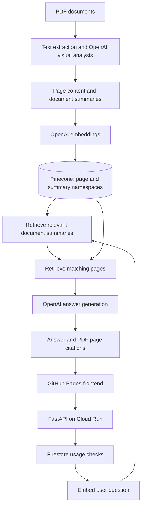

# AI Knowledge Base Assistant

A multimodal retrieval augmented generation (RAG) application that answers questions about a collection of PDF documents using semantic search and language model responses.

**[Try the live demo](https://harrisonfunk2.github.io/chatbot_v2/)** · **[View the source code](https://github.com/harrisonfunk2/chatbot_v2)**

## Overview

The application transforms PDF documents into a searchable knowledge base. It combines extracted PDF text with AI generated descriptions of diagrams, screenshots, code examples, and other visual content, then stores document summaries and page level embeddings in Pinecone.

When a user asks a question, a two stage retrieval system first selects relevant documents using their summaries, then retrieves relevant pages within those documents. An OpenAI model generates a response using the retrieved context and returns references to the source PDF and page numbers.

The backend is built with FastAPI and deployed on Google Cloud Run. A static HTML/CSS/JavaScript frontend is hosted on GitHub Pages.

## Features

- **Multimodal PDF ingestion:** Combines text extraction with OpenAI generated descriptions of visual content, code examples, definitions, and key concepts.
- **Two stage semantic retrieval:** Searches document summaries first, then retrieves relevant pages using document specific metadata filters.
- **Source citations:** Returns PDF filenames and page numbers alongside generated responses.
- **Retrieval and generation evaluation:** Uses MLflow to track retrieval recall and assess answer grounding and relevance.
- **Deployed web application:** Serves a FastAPI backend from Cloud Run and a browser frontend from GitHub Pages.
- **Usage controls:** Uses Firestore for shared hourly/daily request quotas, input/output limits, and a configurable chatbot availability switch.

## Architecture



### Retrieval process

1. **Ingest:** Extract text and generate structured visual descriptions for PDF pages.
2. **Index:** Create document summary nodes and page content nodes, embed them, and upload them to separate Pinecone namespaces.
3. **Retrieve documents:** Compare the question with stored document summary embeddings to identify relevant documents.
4. **Retrieve pages:** Restrict the second stage vector search to page nodes belonging to the selected documents.
5. **Generate:** Provide the retrieved text to an OpenAI language model, requesting a grounded answer with numbered citations.

## Technology stack

| Area | Technologies |
| --- | --- |
| Language and backend | Python, FastAPI, Pydantic |
| LLM and embeddings | OpenAI API |
| Retrieval | LlamaIndex, Pinecone |
| PDF processing | `pypdf`, OpenAI visual analysis |
| Evaluation | MLflow |
| Deployment | Google Cloud Run, GitHub Pages |
| Usage management | Google Cloud Firestore, Secret Manager |
| Frontend | HTML, CSS, JavaScript |

## Repository layout

```text
api/          FastAPI endpoints and Firestore request quotas
config.py     Model, Pinecone, and local path configuration
docs/         GitHub Pages frontend
evaluation/   Retrieval and answer evaluation scripts and question sets
generation/   Response generation and citation validation
ingestion/    PDF parsing, visual analysis, merging, and vector indexing
retrieval/    Two stage retrieval and retrieval experiments
```

Original PDFs, generated document data, local MLflow tracking data, and API credentials are not included in the repository.

## Running locally

Requires Python 3.13 and credentials for OpenAI and Pinecone. Running the ingestion scripts incurs API usage costs.

```bash
python3 -m venv .venv
source .venv/bin/activate
python -m pip install -r requirements.txt
```

Create a local `.env` file in the project root (do not commit it):

```dotenv
OPENAI_API_KEY=your_openai_key
PINECONE_API_KEY=your_pinecone_key
CHAT_ENABLED=true
ENABLE_MLFLOW=false
```

### Indexing your own PDF documents

Place PDFs under `data/documents/`, optionally organized into subject folders.

```bash
python -m pip install pypdf
python -m ingestion.merged
python -m ingestion.index_nodes
```

The processing pipeline writes `data/processed/merged_documents.json` before indexing. **The current scripts reprocess the discovered PDFs when rerun; automatic detection and safe replacement of modified documents are not yet implemented.** Avoid repeatedly rerunning ingestion without considering processing costs and existing index records.

## Evaluation

The repository includes evaluation scripts and question sets for:

- **Retrieval:** Comparing direct semantic search with two-stage retrieval using recall at *k* (1, 3, 5, and 9).
- **Answer generation:** Using MLflow's retrieval-groundedness and query-relevance scorers to assess responses.

Evaluation scripts expect a local MLflow tracking server at `http://127.0.0.1:5000`. They are separate from the public web application's normal request flow.
